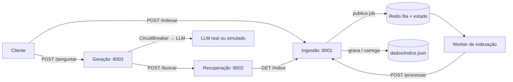

# C2.A2 — RAG distribuído em microsserviços

**Disciplina:** Sistemas Distribuídos e Computação em Nuvem · FAESA · 2026/2
**Unidade:** C2 · Coordenação e consistência
**Tipo de entrega:** trabalho prático · RAG distribuído em microsserviços

O projeto separa ingestão, recuperação e geração em três serviços HTTP. O índice vetorial é persistido em JSON; um worker consome do Redis a fila de ingestão; o serviço de geração consulta o recuperador e protege a chamada ao LLM com circuit breaker. Sem `LLM_API_KEY`, a resposta usa o modo simulado offline do kit.

## Arquitetura



## Requisitos e inicialização

É necessário Docker com Docker Compose. Na pasta `C2_A2_RAG`, crie o arquivo de ambiente e suba os serviços:

```bash
cp .env.example .env
docker compose up --build -d
docker compose ps
```

A chave do LLM é opcional. Para execução offline, deixe `LLM_API_KEY` vazia. Os serviços ficam disponíveis em `http://localhost:8001` (ingestão), `http://localhost:8002` (recuperação) e `http://localhost:8003` (geração). Redis e os serviços também estão na rede interna do Compose. O JSON do índice é mantido em `dados/indice.json` e sobrevive à recriação dos contêineres enquanto a pasta local for preservada.

## Fluxo de ponta a ponta

Envie documentos para indexação. A rota responde `202` com identificador do job; o worker consome a fila e o estado pode ser consultado até ficar `concluido`:

```bash
curl -X POST http://localhost:8001/indexar \
  -H 'Content-Type: application/json' \
  -d '{"documentos":[
    {"texto":"O teorema CAP trata de consistência, disponibilidade e partições de rede.","origem":"aula-cap"},
    {"texto":"Raft é um protocolo de consenso para replicar um log entre servidores.","origem":"aula-raft"}
  ]}'
```

Consulte o job com o `job_id` devolvido:

```bash
curl http://localhost:8001/indexar/SEU_JOB_ID
```

Quando o status for `concluido`, faça uma busca top-k diretamente no recuperador ou envie uma pergunta ao serviço de geração:

```bash
curl -X POST http://localhost:8002/buscar \
  -H 'Content-Type: application/json' \
  -d '{"pergunta":"O que diz o teorema CAP?","top_k":3}'

curl -X POST http://localhost:8003/perguntar \
  -H 'Content-Type: application/json' \
  -d '{"pergunta":"O que diz o teorema CAP?"}'
```

`/perguntar` devolve a pergunta, a resposta e os trechos de contexto usados. O modo simulado não chama serviço externo. As rotas `/saude` dos três serviços permitem uma verificação básica; `/docs` expõe a documentação OpenAPI de cada API.

## Testes e operação

```bash
docker compose logs -f worker ingestao recuperacao geracao
docker compose down                 # preserva os dados e o volume Redis
docker compose down -v              # remove também o estado do Redis
```

Os testes locais verificam a ordenação da busca, persistência do índice e rejeição de parâmetros inválidos. O roteiro de entrega também deve verificar a recuperação após reiniciar ingestão, a operação sem chave de LLM e o comportamento do disjuntor quando o LLM falha repetidamente. Para forçar falhas no LLM, configure um endpoint/chave de teste indisponível e observe `/saude` em geração após três falhas.

## Decisões de consistência e resiliência

A busca do índice usa política de disponibilidade (AP) como decisão de projeto: uma atualização recém-enfileirada pode não aparecer imediatamente em uma consulta, mas a indexação é confirmada pelo estado do job antes de o cliente depender dela. Para um índice vetorial replicado, aceitamos convergência eventual e atraso curto de indexação para manter consultas de leitura disponíveis. Casos que exigem refletir imediatamente uma remoção por segurança ou conformidade precisam de validação forte adicional e não devem depender apenas desta política AP.

## Estrutura

- `servicos/ingestao/`: API de indexação, persistência em arquivo e consulta de estado.
- `servicos/recuperacao/`: busca TF-IDF por similaridade do cosseno.
- `servicos/geracao/`: composição do contexto, cliente LLM e circuit breaker.
- `servicos/ingestao/worker.py`: consumidor da fila Redis.
- `documentos/`: documentos curtos de teste fornecidos no kit.
- `dados/`: armazenamento persistente do índice.
- `tests/`: testes automatizados locais.

## Referências

- Kit C2.A2 do professor: https://github.com/howardroatti/sd-2026-2-kit-c2a2
- Laboratório da Aula 10 — CAP: https://howardroatti.github.io/sistemas-distribuidos-faesa/aulas/lab-10-missoes.html
