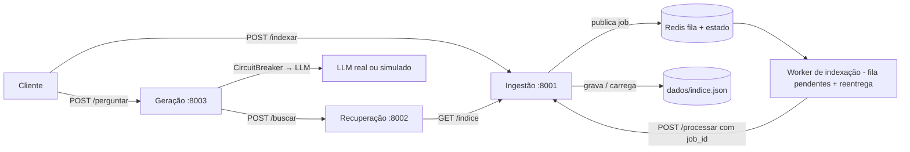

# C2.A2 — RAG distribuído em microsserviços

**Disciplina:** Sistemas Distribuídos e Computação em Nuvem · FAESA · 2026/2
**Unidade:** C2 · Coordenação e consistência
**Tipo de entrega:** trabalho prático · RAG distribuído em microsserviços

O projeto separa ingestão, recuperação e geração em três serviços HTTP. O índice vetorial é persistido em JSON; um worker consome do Redis uma fila de ingestão com recuperação de mensagens pendentes; o serviço de geração consulta o recuperador e protege a chamada ao LLM com circuit breaker. Sem `LLM_API_KEY`, a resposta usa o modo simulado offline do kit.

## Arquitetura



## Requisitos e inicialização

É necessário Docker com Docker Compose. Na pasta `C2_A2_RAG`, crie o arquivo de ambiente e suba os serviços:

No **Windows (PowerShell)**:

```powershell
Copy-Item .env.example .env
docker compose up --build -d
docker compose ps
```

No **Linux/macOS**:

```bash
cp .env.example .env
docker compose up --build -d
docker compose ps
```

Se já existir `.env`, não é necessário copiá-lo novamente. **Não publique a chave de API no GitHub.**

A chave do LLM é opcional. Para execução offline, deixe `LLM_API_KEY` vazia. A chamada real usa timeout configurável por `LLM_TIMEOUT` (20 segundos por padrão), até `LLM_MAX_TENTATIVAS` tentativas (3 por padrão) para timeouts, falhas de conexão, HTTP 429 e erros HTTP 5xx; a espera entre tentativas aumenta progressivamente a partir de `LLM_ESPERA_RETENTATIVA` (0,5 segundo por padrão). Erros HTTP 4xx permanentes não são repetidos. O circuit breaker envolve a operação completa, inclusive as retentativas, e conta uma falha depois que elas se esgotam. Os serviços ficam disponíveis em `http://localhost:8001` (ingestão), `http://localhost:8002` (recuperação) e `http://localhost:8003` (geração). Redis e os serviços também estão na rede interna do Compose. O JSON do índice é mantido em `dados/indice.json` e sobrevive à recriação dos contêineres enquanto a pasta local for preservada.

## Fluxo de ponta a ponta

Envie documentos para indexação. A rota responde `202` com identificador do job; o worker consome a fila e o estado pode ser consultado até ficar `concluido`:

```bash
curl -X POST http://localhost:8001/indexar \
  -H 'Content-Type: application/json' \
  -d '{"documentos":[
    {"texto":"O teorema CAP trata de consistência, disponibilidade e partições de rede.","origem":"aula-cap"},
    {"texto":"Raft é um protocolo de consenso para replicar um log entre servidores.","origem":"aula-raft"}
  ]}'
```

Consulte o job com o `job_id` devolvido:

```bash
curl http://localhost:8001/indexar/SEU_JOB_ID
```

Quando o status for `concluido`, faça uma busca top-k diretamente no recuperador ou envie uma pergunta ao serviço de geração:

```bash
curl -X POST http://localhost:8002/buscar \
  -H 'Content-Type: application/json' \
  -d '{"pergunta":"O que diz o teorema CAP?","top_k":3}'

curl -X POST http://localhost:8003/perguntar \
  -H 'Content-Type: application/json' \
  -d '{"pergunta":"O que diz o teorema CAP?"}'
```

`/perguntar` devolve a pergunta, a resposta, os trechos de contexto e `fontes` (origens dos documentos encontrados). Quando nenhum trecho apresenta similaridade positiva, a resposta informa que não há contexto suficiente **sem chamar o LLM**. Se a API real falhar, responde com status 502 ou 503 e preserva o contexto e as fontes no campo `detail`, evitando uma resposta inventada. O modo simulado não chama serviço externo. As rotas `/saude` dos três serviços permitem uma verificação básica; `/docs` expõe a documentação OpenAPI de cada API.

## Testes e operação

Na pasta `C2_A2_RAG`, com Docker Desktop ativo, execute os **testes unitários** incluídos na imagem:

```bash
docker compose --profile test run --build --rm testes
```

Para verificar o sistema **de ponta a ponta**, primeiro suba os serviços e execute o roteiro integrado dentro do contêiner de geração:

```bash
docker compose up --build -d
docker compose ps
docker compose exec geracao python scripts/testar_fluxo.py
```

O script envia documentos pelo serviço de ingestão, aguarda a fila Redis e o worker concluírem a tarefa, faz a recuperação e confere que a resposta da geração contém fontes. Com `LLM_API_KEY` vazia, funciona no modo simulado, sem API externa. O modo simulado **não testa** circuit breaker e retentativas reais; estes são cobertos por testes unitários e devem também ser validados com um endpoint de falhas controlado.

Comandos úteis:

```bash
docker compose logs -f worker ingestao recuperacao geracao
docker compose down                 # preserva dados/indice.json e o Redis
docker compose down -v              # remove o volume Redis, mas não dados/indice.json
```

Para refazer uma demonstração com índice vazio, remova manualmente `dados/indice.json` **com os contêineres parados**. O worker deve ser único: a recuperação de tarefas pendentes na inicialização foi projetada para **uma réplica**. Cada job tem um `job_id` persistido no índice para impedir duplicação em caso de reentrega. Jobs com falhas transitórias são tentados novamente até três vezes. Isso é uma recuperação simples, **não** uma solução distribuída de múltiplos consumidores.

Os testes automatizados incluem persistência, busca, rejeição de contexto irrelevante, idempotência, respostas sem documentos, circuit breaker, erros e retentativa do LLM. **Ainda é necessário executar o Docker Compose em um computador com Docker** e observar o script integrado; os testes isolados não substituem essa verificação.

## Decisões de consistência e resiliência

O fluxo adota indexação assíncrona e visibilidade eventual de documentos recém-inseridos; isso não comprova, por si só, uma classificação formal AP do sistema completo: uma atualização recém-enfileirada pode não aparecer imediatamente em uma consulta, mas a indexação é confirmada pelo estado do job antes de o cliente depender dela. Para um índice vetorial replicado, aceitamos convergência eventual e atraso curto de indexação para manter consultas de leitura disponíveis. Casos que exigem refletir imediatamente uma remoção por segurança ou conformidade precisam de validação forte adicional e não devem depender apenas desta política AP.

## Estrutura

- `servicos/ingestao/`: API de indexação, persistência em arquivo e consulta de estado.
- `servicos/recuperacao/`: busca TF-IDF por similaridade do cosseno.
- `servicos/geracao/`: composição do contexto, cliente LLM e circuit breaker.
- `servicos/ingestao/worker.py`: consumidor da fila Redis.
- `documentos/`: documentos curtos de teste fornecidos no kit.
- `dados/`: armazenamento persistente do índice.
- `tests/`: testes automatizados (executáveis via Compose).
- `scripts/testar_fluxo.py`: teste real de ponta a ponta (executável no contêiner).
- `ALTERACOES_C2_A2.md`: resumo das correções e do que foi efetivamente validado.

## Referências

- Kit C2.A2 do professor: https://github.com/howardroatti/sd-2026-2-kit-c2a2
- Laboratório da Aula 10 — CAP: https://howardroatti.github.io/sistemas-distribuidos-faesa/aulas/lab-10-missoes.html
